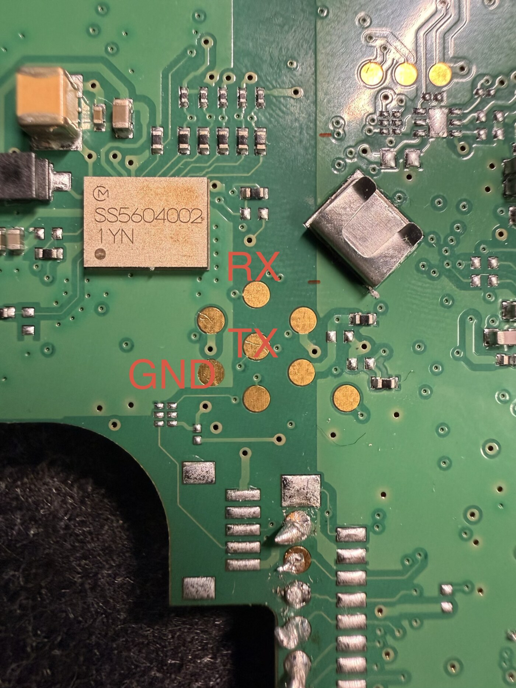
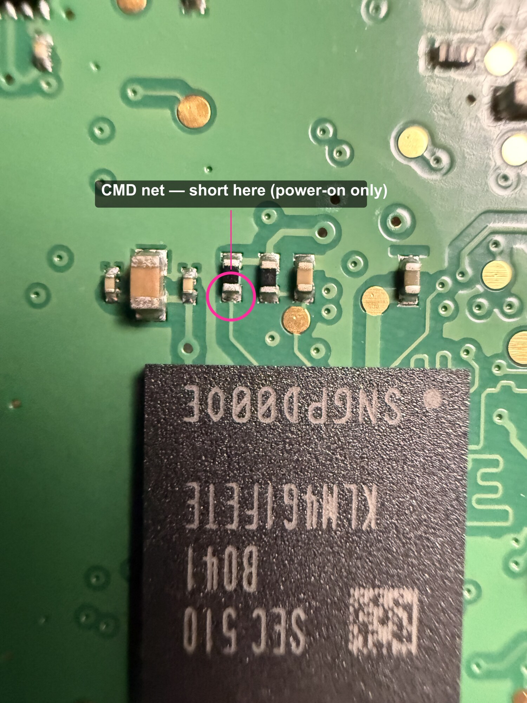

# BTicino Classe 300X (344642): recovering and rooting firmware (2.0.2 & 3.0.6) over UART + i.MX6 SDP

## ⚠️ Disclaimer: read this first

This is hardware-level work on a door-entry intercom. **You can permanently destroy the device.**
One of the two units this was developed on was destroyed by a single wrong move (grounding a
supply pad while the board was running).

- Everything here is provided **as is, without warranty**, at your own risk. The authors are not
  affiliated with, endorsed by, or supported by BTicino / Legrand, NXP, Home Assistant or anyone else.
- It will almost certainly **void your warranty**. Do not use these steps on a unit you are not
  entitled to modify, and do not misrepresent a damaged unit to a retailer.
- The intercom is a **security device** (it opens your door). A rooted unit with a default
  password on your LAN is a risk. Change the password, keep it off the internet, and think about
  who can reach it.
- Mains/bus wiring is not involved, but you will be soldering to a live PCB. If you are not
  comfortable with that, stop here.
- This repository contains **no BTicino firmware, no bootloader dump and no device backups**.
  You must download your own firmware from BTicino and back up your own unit.
- Do **not** run any of this on a unit you can't afford to lose until you have read it all.

## What this is

A reproducible, low-level way to get into a Classe 300X without the vendor update path:

1. a UART console,
2. a way to force the CPU into USB recovery (i.MX6 "SDP") and RAM-boot a custom U-Boot,
3. use that U-Boot's USB mass storage mode (`ums`) so the unit's eMMC appears as a disk on your
   computer,
4. back it up, and write a normal or lightly modified root filesystem to it with `dd`.

It is the "rawest" approach: nothing is flashed to the bootloader, and the stock U-Boot is never
touched. It also **recovers units that look bricked** (boot loops, "apply loops", missing files),
provided the eMMC itself is physically healthy.

This repo contains **no BTicino firmware, bootloader dump or device backup.** Bring your own.

You need: a 3.3 V USB-UART adapter, a USB cable to the unit's micro-B/USB port, `imx_usb_loader`
(built, included config maps this device), and `e2fsprogs` if you want to build a modified rootfs.
A fine-tipped probe or a short jumper wire for step 2.

I did all of this on macOS, but with a Linux VM for building U-Boot as modern Apple `ld` is _picky_

---

## 1. UART console

- UART header pins are on the bus connector side of the PCB, just under the main IC (biggest chip on the board).
- Console is on **`ttymxc2`**, pads **`EIM_D24` (TX)** and **`EIM_D25` (RX)**, **115200 8N1, 3.3 V**.



## 2. Force USB recovery (SDP)

The i.MX6 boot ROM boots from the eMMC. If it **cannot read the eMMC boot area**, it falls back to
**USB Serial Download (SDP)**, enumerating as USB `15a2:0061`. That is the mode we want: it lets us
RAM-boot our own U-Boot without writing anything.

The route there is via U-Boot. The stock installed version doesn't let us break out of autoboot (it's been disabled) 
so we have to trip glitch the eMMC lines on boot which will give us a U-Boot console. 

1. Identify the **eMMC CMD net**: it is the **bottom end cap of the resistor** (the end nearer the eMMC
   package), circled below — the ~10 kΩ CMD pull-up.

   
2. **At power-on**, hold that point to ground **briefly** with a probe. The ROM still reads enough to
   reach a U-Boot prompt, but autoboot's kernel load from eMMC fails — leaving you at the stock
   U-Boot prompt. **Release as soon as you have the prompt.**
3. At the prompt, type `bmode usb`. The board resets into SDP (`15a2:0061`), confirmable with
   `imx_usb_loader`'s `uuu -lsusb`.

## 3. RAM-boot our U-Boot and enter `ums` disk mode

With the board in SDP (`15a2:0061`), from `imx_usb_loader/` load the two images from
[`uboot/`](uboot/) — stage 1, then stage 2:

```sh
sudo ./imx_usb -v /path/to/community/uboot/u-boot-with-spl.imx
sudo ./imx_usb -v /path/to/community/uboot/u-boot.uim
```

Our U-Boot now runs **in RAM** (nothing was written to the device). On the UART prompt, expose the
eMMC as a USB disk:

```
=> ums 0 mmc 2
```

The eMMC appears on your computer as a ~3.6 GiB disk. **Confirm the size is `3909091328` bytes before
you touch it** — if it's a different size you're looking at the wrong disk.

See [`uboot/README.md`](uboot/README.md) for what these images are, how to build them yourself, and
the licensing note (short version: mainline U-Boot v2018.07 + a two-line patch, GPL, fine to share).

## 4. Back up the eMMC (do this first, always)

Find the disk node (macOS: `diskutil list`; Linux: `lsblk`). Below it's `/dev/rdiskN` (macOS raw node;
on Linux use `/dev/sdX`). **Double-check the node** — writing to the wrong disk destroys your computer's
data.

```sh
# full user-area image (~3.6 GiB, ~12 min at ~5.5 MB/s)
sudo dd if=/dev/rdiskN of=emmc_user_full.img bs=4m
shasum -a 256 emmc_user_full.img      # keep this somewhere safe
```

Keep this backup. It contains your p7 config partition (keys, settings, answering-machine data) and
lets you restore the exact original.

## 5. Write a rootfs to p6

**p6** (the normal rootfs) starts at **sector 520192 = 254 MiB** and is **1 GiB**. Write your image
there and verify the read-back before power-cycling:

```sh
# write a 1 GiB rootfs image to p6
sudo dd if=your-rootfs.ext4 of=/dev/rdiskN bs=1m seek=254

# verify: read p6 back and compare hashes
sudo dd if=/dev/rdiskN bs=1m skip=254 count=1024 | shasum -a 256
shasum -a 256 your-rootfs.ext4
```

When the hashes match: `Ctrl-C` the `ums` on the UART, then **power-cycle with nothing shorted**. The
unit boots the new p6.

### What to write

- **Stock recovery:** extract `btweb_only.ext4` (the 1 GiB *normal* rootfs, not the recovery one) from
  your own firmware and write it as-is. This returns the unit to factory behaviour.
- **Rooted:** [`rootfs-mod/make-minimal-mod.sh`](rootfs-mod/make-minimal-mod.sh) builds a minimally
  modified rooted image. It works entirely offline (no mount, no root, uses `debugfs`), auto-detects
  the firmware (**2.0.2 or 3.0.6**), and makes only three changes — everything else stays byte-identical:
    1. sets a root password (hash method matched to stock: `$6$` on 2.0.2, `$5$` on 3.0.6);
    2. installs an **independent SSH daemon** (`/etc/init.d/c300x-ssh`) with its own pidfile, a watchdog,
       and persistent host keys on p7. The firmware's `bt_daemon` stops the *factory* dropbear a few
       minutes after boot (it treats SSH as disabled unless `<abil_ssh>` is set in its config); this
       separate instance has its own pidfile so that stop can't touch it. It also generates an ECDSA
       host key, so modern SSH clients connect without legacy options;
    3. disables the firmware auto-updater (`SmartToolHLS`) by blanking `WebDispatcher=` and setting
       `autoInstall=0` — otherwise the unit silently pulls and installs a new firmware (which overwrites
       p6 and undoes your mods; this happened to me overnight).
  ```sh
  rootfs-mod/make-minimal-mod.sh btweb_only.ext4.gz mod.ext4 --password 'choose-a-strong-one'
  # flags: --no-ssh, --keep-updates, --json-dir <CPython2.7 Lib/json> (for the HA integration, 2.0.2)
  ```

### After it boots (rooted image)

- UART login as `root`. SSH works with a plain `ssh root@<ip>` (the `c300x-ssh` daemon offers an ECDSA
  host key). The host key persists on p7, so your client won't warn after a reboot.
- The root filesystem is **read-only** at runtime: `mount -o remount,rw /` to edit, then back to `ro`.
- The script already disables the auto-updater, but **keeping the unit off the internet** is still the
  safest belt-and-braces against a firmware that overwrites p6.


---

## Support this work

If this saved your intercom (or your weekend), you can say thanks here:

[](https://ko-fi.com/B0B6DU4A3)

No pressure, and no part of this guide is gated behind it. I'm down one device from a shorted eMMC.

---

*Not affiliated with BTicino, Legrand, NXP, or Home Assistant. Names and trademarks belong to their
respective owners. Provided as-is, for interoperability and repair of hardware you own.* 